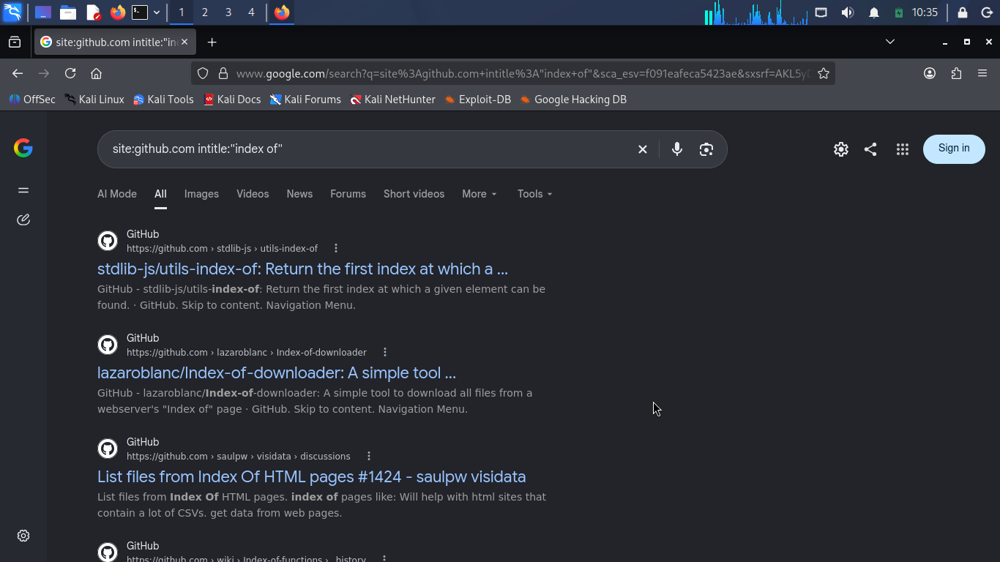
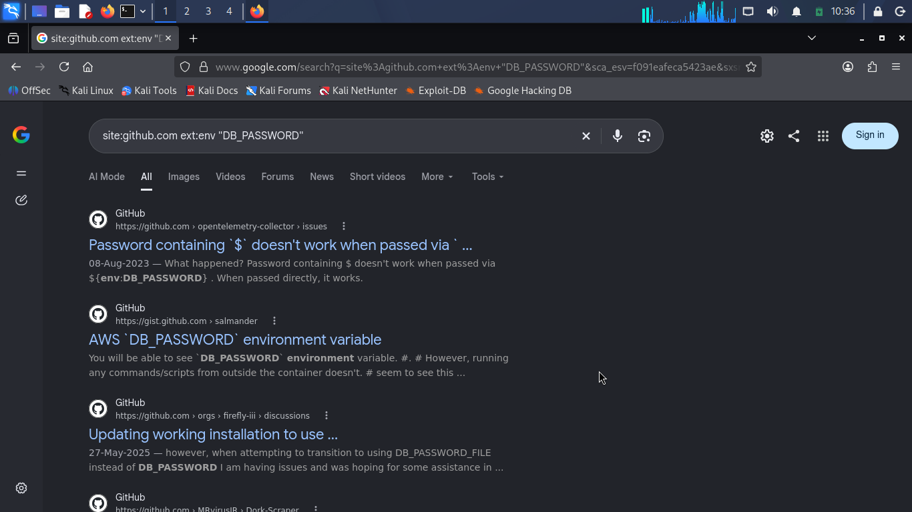
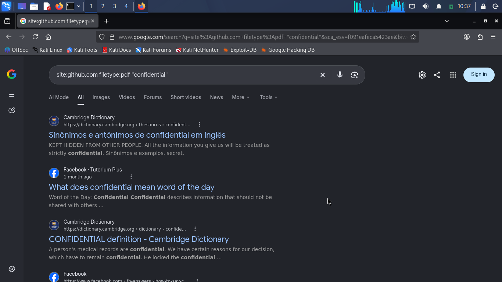
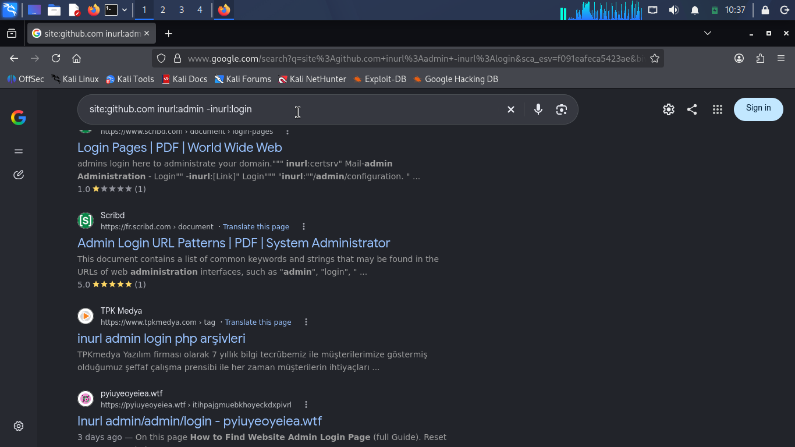
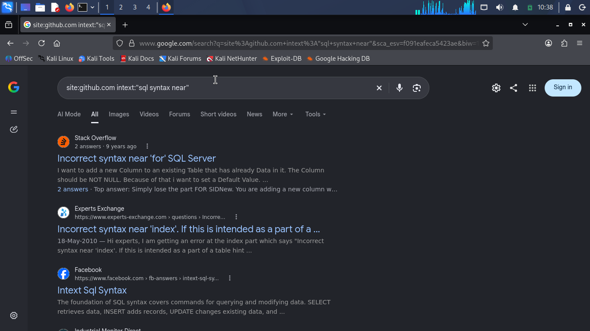
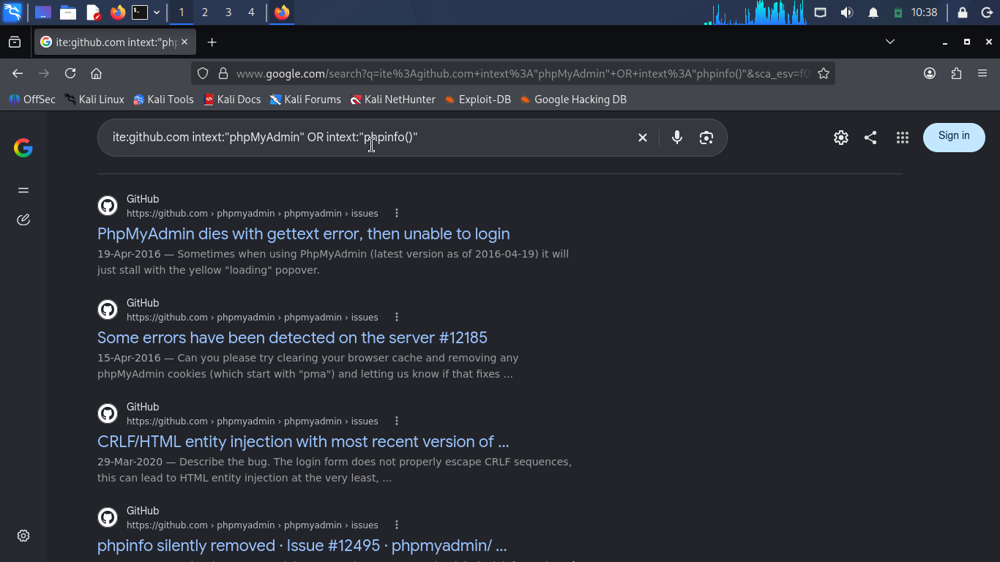
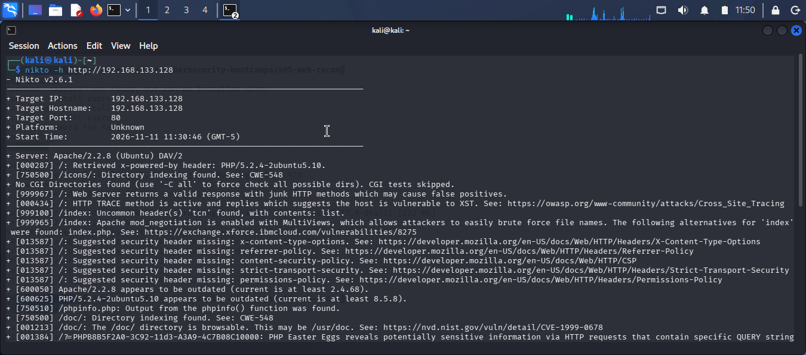

# Day 5: Web App Pentesting and Reconnaissance

## Task 1: Scope Document and Rules of Engagement

**Engagement:** Web Application Penetration Test
**Target:** Intel Corporation (`*.intel.com`)
**Classification:** Grey-box (Credentials will be provided)

### 1. Scope
* **In Scope:** All subdomains resolving to `*.intel.com` and their associated REST APIs.
* **Explicitly Out of Scope:** `career.intel.com` (HR portal and applicant data are strictly excluded from this assessment).
* **Break-Glass Clause:** A wildcard scope such as `*.intel.com` includes all current and future subdomains, as well as any third-party services pointed at that zone. Should testing require access to a newly discovered host that may be out of scope, the tester must halt and contact the Primary Emergency Contact for written authorisation before sending any packets to that host.

### 2. Prohibited Techniques
* No Denial of Service (DoS) or stress testing that could degrade availability.
* No social engineering (phishing, vishing) against Intel employees.
* No physical access attempts.

### 3. Access Granted
* Two test accounts will be provided (one standard user, one administrative) to test authorization and privilege escalation logic.
* VPN access and jump-server details will be provided to reach the staging environment.

### 4. Testing Window
* **Dates:** October 1st to October 14th.
* **Hours:** 22:00 to 04:00 EST (outside business hours) to prevent disruption to production systems.

### 5. Rules of Engagement (RoE)
* **Written Authorisation:** Testing will not commence until the signed Rules of Engagement and Statement of Work are executed.
* **Data Minimisation:** If sensitive customer records are discovered, access will be proven using a single record and testing will immediately stop to protect PII.
* **No Destructive Actions:** Under no circumstances will data be deleted, modified, or encrypted.
* **Reporting:** Critical findings (e.g., active compromise or PII exposure) will be reported to the Emergency Contact immediately, rather than waiting for the final report.
* **Data Destruction:** All test data, logs, and screenshots will be securely destroyed 30 days after the final report is delivered, with written confirmation provided.

### 6. Emergency Contact & Stop Procedure
* **Name:** Jane Doe (Security Operations Manager)
* **Direct Phone:** +1 (555) 019-8372
* **Stop Procedure:** If the client requests a halt to testing, the tester will immediately cease all active scans, disconnect the VPN, and confirm the stop in writing via email.


## Task 2: Dork Report

**Target Domain:** `github.com` (Public domain, used for educational demonstration)  
**Tools Used:** Google Search Operators (Dorks)

### Dork 1: Open Directory Listings
* **Dork:** `site:github.com intitle:"index of"`
* **Result:** Search results showed repository utility libraries (such as `stdlib-js/utils-index-of`) and tool repositories referencing directory listing tools rather than open web server directory listings[cite: 1].
* **Fix:** Disable directory listings in the web server configuration or add authentication.
* 

### Dork 2: Environment Files with Passwords
* **Dork:** `site:github.com ext:env "DB_PASSWORD"`
* **Result:** Results displayed GitHub repository issues and public Gists discussing environment variable configuration issues rather than raw, live database environment files[cite: 2].
* **Fix:** Remove `.env` files from public web roots and use environment variables at the server level.
* 

### Dork 3: Confidential PDF Documents
* **Dork:** `site:github.com filetype:pdf "confidential"`
* **Result:** Search results yielded dictionary definitions and general web page entries for the word "confidential" rather than indexed PDF documents hosted on GitHub[cite: 3].
* **Fix:** Ensure sensitive documents are stored behind authentication and not indexed by search engines.
* 

### Dork 4: Admin Interfaces
* **Dork:** `site:github.com inurl:admin -inurl:login`
* **Result:** Results listed external PDF documents and article references indexed by search engines regarding admin URL patterns and login scripts[cite: 4].
* **Fix:** Protect admin panels behind IP allowlists, VPNs, or strong authentication.
* 

### Dork 5: Database Error Messages
* **Dork:** `site:github.com intext:"sql syntax near"`
* **Result:** Results showed community forum threads from Stack Overflow and Experts Exchange discussing SQL syntax error troubleshooting[cite: 5].
* **Fix:** Disable verbose error reporting in production environments.
* 

### Dork 6: PHP Info Disclosure
* **Dork:** `site:github.com intext:"phpMyAdmin" OR intext:"phpinfo()"`
* **Result:** Search results revealed open issue discussions on the official phpMyAdmin GitHub repository concerning bug reports and authentication errors[cite: 6].
* **Fix:** Remove `phpinfo.php` files and restrict `phpMyAdmin` access.
* 


## Task 3: Subdomain Reconciliation

**Target Domain:** `intel.com`
**Tools Used:** Subfinder, Assetfinder, crt.sh (Certificate Transparency)

### 1. Enumeration Results & Deduplication
After running the three tools, we combined the outputs and deduplicated them to find the true attack surface. 

*   **Subfinder:** Found 12,060 subdomains.
*   **Assetfinder:** Found 6,203 subdomains.
*   **crt.sh:** Found 3,838 subdomains.
*   **Final Deduplicated List:** **14,145 unique subdomains.**

### 2. Analysis: What did each tool find that the others missed?
*   **Subfinder** produced the largest single list (12,060), pulling from a vast array of passive sources and APIs. It found thousands of development and internal staging subdomains (e.g., `dev.intel.com`, `staging.intel.com`) that were not present in the other lists.
*   **crt.sh** found 3,838 entries. While smaller, it is highly valuable because it relies *only* on public SSL/TLS certificate issuance. This often reveals legacy or forgotten servers that are no longer linked to the main website but still have valid certificates.
*   **Assetfinder** found 6,203 entries. It excelled at finding related domains and third-party hosted services (like `intel.s3.amazonaws.com` or Azure/AWS hosted instances) that the other tools missed.

The final deduplicated list of **14,145** proves that no single tool is enough. The union of all three is significantly larger than any individual result.

### 3. Sample of the Deduplicated Subdomain List (First 20 entries)
Because the full list contains 14,145 entries, only a sample is shown here:
```
0gz4behs.intel.com
0gz4behs-test.intel.com
10millionteachers.intel.com
1e9e7f2f-8af1-4c79-9ee0-e45f9d57a920.intel.com
1source-gh.intel.com
1source-github-actions.fm.intel.com
1source-github-actions.intel.com
1source-github-actions-pre.fm.intel.com
1source-github-actions-pre.intel.com
1tas2-api.intel.com
1tas2-core.intel.com
1tas2-db.intel.com
1tas2-dev-api.intel.com
1tas2-dev-core.intel.com
1tas2-dev-db.intel.com
1tas2-dev.db.intel.com
1tas2-dev.intel.com
1tas2-dev-jks.intel.com
1tas2-dev-portal.intel.com
1tas2-dev-sche.intel.com
```


## Task 4: Scanner Comparison

**Target:** `http://192.168.133.128` (Metasploitable 2 Lab)
**Tools Used:** OWASP ZAP (Community Edition GUI) & Nikto (CLI)

### 1. What each tool found
*   **OWASP ZAP:** When running an active scan, ZAP focuses on the application layer. It found things like SQL Injection, Cross-Site Scripting (XSS) in forms, and missing CSRF tokens. (Note: ZAP requires a full GUI scan to populate alerts).
*   **Nikto (Server Scanner):** As seen in the output, Nikto focused on server misconfigurations. It identified that the server is running an outdated Apache version (`2.2.8`), found directory indexing (`/doc/`, `/icons/`), exposed the `/phpinfo.php` file, exposed a `phpMyAdmin` installation, and flagged missing HTTP security headers (like `X-Content-Type-Options` and `Content-Security-Policy`). It also found PHP Easter eggs via specific query strings.

### 2. Comparison: What did each find that the other missed?
*   **ZAP's strength:** ZAP finds **application logic flaws**. It interacts with forms and inputs to find XSS and SQL injections.
*   **Nikto's strength:** Nikto is a **server-focused** scanner. It found the exposed `phpinfo.php`, the open `/doc/` directories, and the outdated Apache version. ZAP's spider might miss `/doc/` because there are no links to it on the main page. 
*   **Why they differ:** ZAP acts like a user clicking around the website. Nikto acts like a server auditor, brute-forcing common directories and checking server banners. A complete assessment requires both tools.

* 
